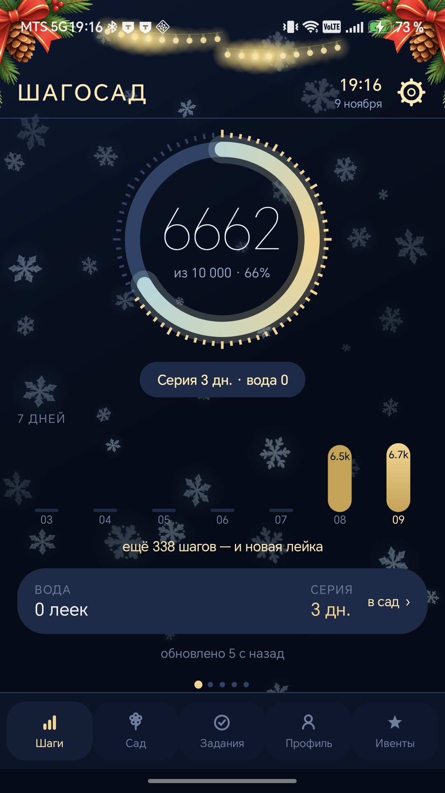
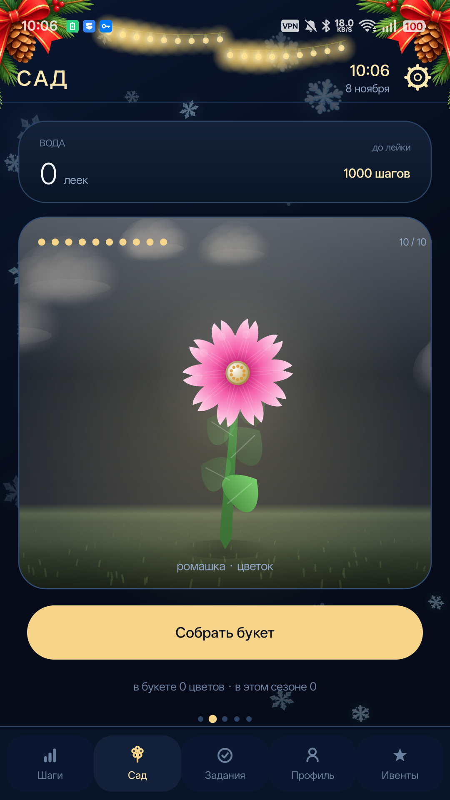
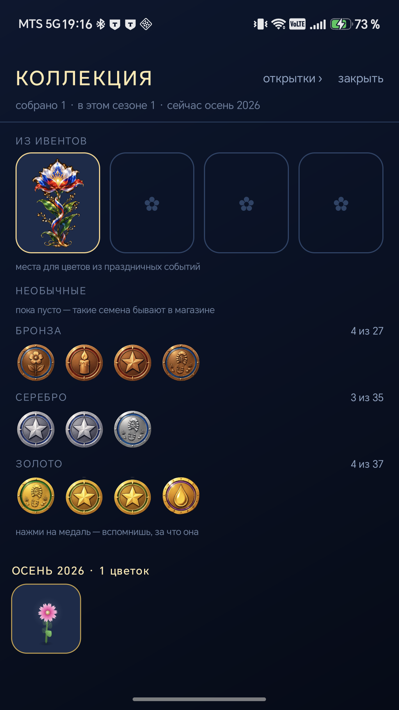
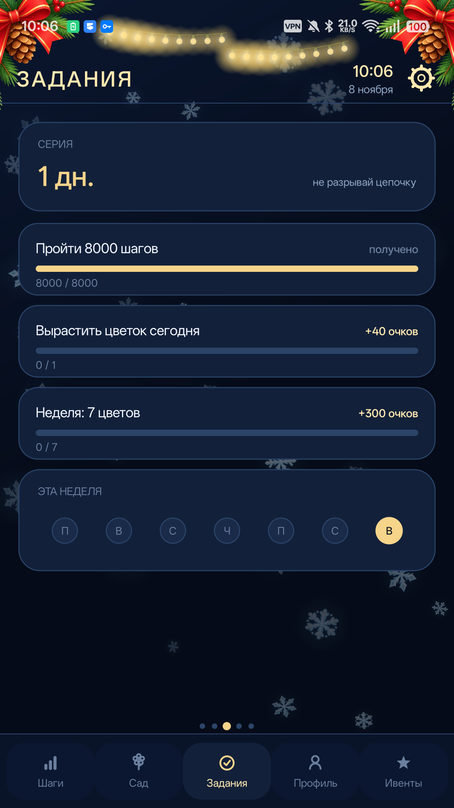
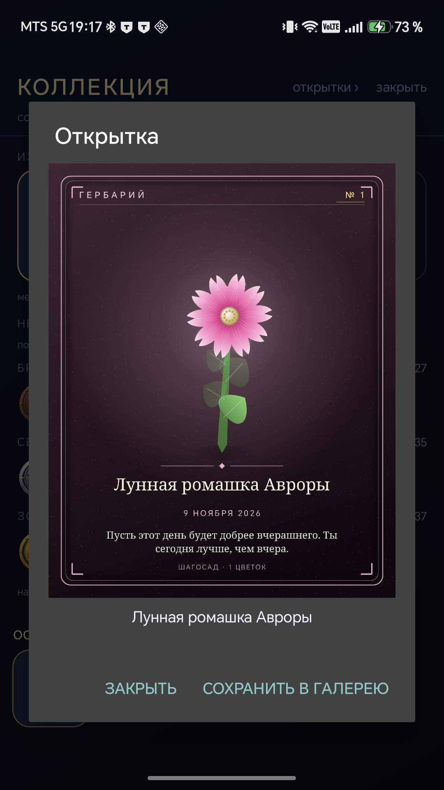

# ШагоСад

**Коллекционная игра о шагах для Android.** Шаги превращаются в воду, вода — в цветы,
а каждый выращенный цветок становится открыткой в гербарии: имя, дата, пожелание.

Фоновой службы нет: шаги читаются прямо с датчика телефона — низкий расход батареи,
постоянного уведомления в шторке тоже нет. Работает без интернета. Сеть нужна только для двух вещей:
небо в саду рисуется по настоящей погоде и высоте солнца, а в сборке с GitHub —
ещё и проверка обновлений. Без сети сад остаётся «полднем и ясной погодой»,
игра не ломается.

<p align="center">
  
  
  
</p>

<p align="center">
  
  
</p>

## Скачать

<p align="center">
  <a href="https://github.com/muzikamv-dot/shagosad/releases/latest/download/ShagoSad.apk">
    
  </a>
</p>

**Прямая ссылка** (всегда самый свежий релиз, ничего искать не нужно):

https://github.com/muzikamv-dot/shagosad/releases/latest/download/ShagoSad.apk

- все версии и что в них изменилось: [releases](https://github.com/muzikamv-dot/shagosad/releases)
- резервная ссылка на файл в репозитории:
  [dist/ShagoSad.apk](https://github.com/muzikamv-dot/shagosad/raw/main/dist/ShagoSad.apk)
- **RuStore:** https://www.rustore.ru/catalog/app/com.dsh.stepcounter

Обновляться удобно через [Obtainium](https://github.com/ImranR98/Obtainium): добавьте
`https://github.com/muzikamv-dot/shagosad` как источник типа GitHub.
Android при установке спросит разрешение на установку из браузера и может
предупредить через Play Protect: приложение подписано локальным ключом
разработчика, а не собрано в Google Play.

## Что умеет

- **Шаги** из аппаратного счётчика (`TYPE_STEP_COUNTER`) — подхватываются сами
  при открытии и при возврате в приложение, кнопки «обновить» нет.
- **Вода за шаги:** лейка за каждую десятую часть дневной нормы (по умолчанию 10 000 шагов).
- **Сад:** цветок растёт по стадиям, его поливают и собирают в букет. Сцена живая:
  небо меняется по высоте солнца, облака — по реальной облачности, луна в своей фазе.
- **Цветы не заканчиваются:** силуэт, лепестки, листва и палитра собираются заново
  для каждого цветка, поэтому после первых 365 видов находятся новые.
- **Коллекция по сезонам:** осень, зима, весна, лето. Собранные открытки цветные,
  остальные — силуэтами; у каждой видно имя цветка, дату и пожелание.
- **Задания** дня и недели, 12 званий от «Новичка» до «Сад-вселенной»,
  99 достижений с медалями — бронза, серебро, золото, у каждой свой рисунок.
- **Праздники — секрет:** по праздникам в игре появляются события со своим заданием,
  украшениями и цветком. Какие праздники и что внутри — не рассказываем: открывай игру
  в праздничные дни и замечай. Неизменно одно: праздничный цветок нельзя вырастить
  в саду или купить — он существует только в событии.- **Магазин:** рамки для аватарки, инструменты и семена. Волшебная ромашка — семя,
  которое даёт необычный цветок, каких в саду случайно не встретить; он хранится
  в разделе «необычные», чтобы не смешиваться с сезонными.
- **Сорняки и увядание:** пропустил норму — на цветке сорняки, вода копится вдвое
  медленнее; три пропуска подряд — цветок засыхает, нужна лопата, чтобы перекопать
  и посадить то же семя. После недели отсутствия лопату дают бесплатно.
- **Инвентарь** в профиле: сколько тяпок и лопат в запасе.
- **Семь тем:** ночной сад, обсидиан, лаванда, кавай, светлая, OLED (настоящий
  чёрный, без свечения) и новогодняя.
- **Обновления:** в сборке из GitHub — проверка в настройках и окно при запуске;
  в сборке из RuStore обновления приходят из магазина, кнопки проверки нет.

## Как устроено

Чистая Java, без сторонних библиотек и без androidx: нет Gradle, нет зависимостей.
Сборка руками: `aapt2` → `javac` → `d8` → `zip` → `apksigner` (скрипт `build.ps1`).

- **Интерфейс нарисован на Canvas:** кольцо шагов, график истории, задания, сад,
- **Цветок — параметрическая модель**, а не спрайты: стебель кривой Безье, листья
  на узлах, лепестки кольцами по золотому углу 137,5°, ветер. Картинки (медали,
  рамки, ивенты) лежат отдельно в WebP и подгружаются только нужные.
- **Данные** — обычные файлы `garden.json` и `journal.txt`, без базы данных.
  Шаги за день считаются разбором интервалов журнала, поэтому день закрывается
  точно, даже если приложение не открывали неделю.
- **Свои краски:** палитры в `Theme.java`, переключение на лету (с пересозданием
  активностей, потому что цвета вкомпилированы во вью).
- **Ивенты** приходят отдельными сборками: своя сцена, своя ёлка, свои открытки.

## Структура

| путь | что внутри |
|---|---|
| `app/src/com/dsh/stepcounter/` | 56 классов: экраны, отрисовка, состояние игры, датчик |
| `app/res/` | 260 файлов: медали, рамки, ивентовые картинки, иконка, тема |
| `app/AndroidManifest.xml` | активности, служба, разрешения |
| `dist/` | собранный и подписанный APK (5,4 МБ) |
| `screenshots/` | снимки экранов |
| `build.ps1` | сборка, установка на телефон по USB, сборка для магазина |
| `PROJECT.md` | паспорт проекта: экраны, константы, решения, история версий, исправленные баги |

## Сборка

Нужно: JDK 17, Android SDK build-tools и `android.jar` (API 35). Пути к ним —
в начале `build.ps1`, подставьте свои.

```powershell
pwsh -File build.ps1                         # собрать APK для GitHub (с проверкой обновлений)
pwsh -File build.ps1 -Install                # собрать и поставить на телефон по USB
pwsh -File build.ps1 -FreshRes               # пересобрать все ресурсы
pwsh -File build.ps1 -Store -Out out-store   # собрать версию для магазина (без обновлялки)
pwsh -File build.ps1 -Install -NoPhone       # выгрузить в папку телефона, но не ставить
```

Подпись: ключа в репозитории нет. Пароль берётся из переменной `STEP_KS_PASS` или
из локального `secrets.local.ps1` (он в `.gitignore`). Чужой ключ сборка не примет —
сверяет отпечаток сертификата с установленным APK.

## Документация

Всё, что нужно знать о внутренностях, — в [PROJECT.md](PROJECT.md): правила механики,
размеры экранов, константы, принятые решения, что уже сломали и как починили.

## Лицензия

**PolyForm Strict 1.0.0** — см. [LICENSE.md](LICENSE.md).
Код открыт для чтения, но использовать его в своих приложениях, изменять и
распространять нельзя. Подробности — в тексте лицензии.
