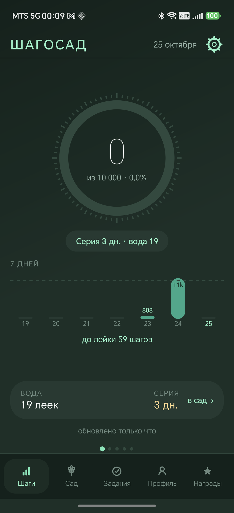
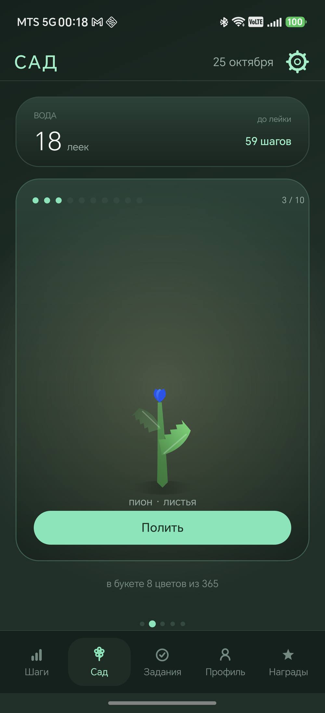
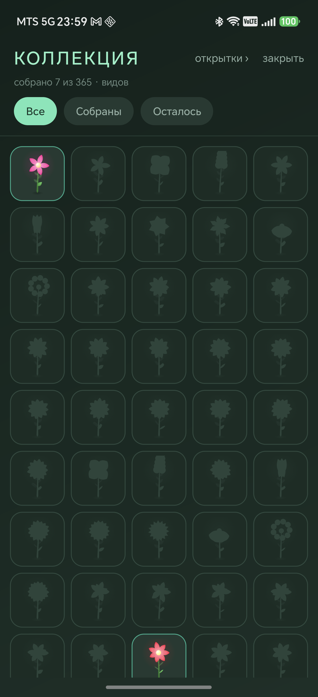

# ШагоСад

**Коллекционная игра о шагах для Android.** Шаги превращаются в воду, вода — в цветы,
а каждый выращенный цветок становится открыткой в коллекции.
Полностью офлайн: приложение не запрашивает ни одного сетевого разрешения.

<p align="center">
  
  
  
</p>

## Что умеет

- **Шаги** из аппаратного счётчика (`TYPE_STEP_COUNTER`) — подхватываются сами
  при открытии и при возврате в приложение, кнопки «обновить» нет.
- **Вода за шаги:** лейка за каждую десятую часть нормы.
- **Сад:** 365 видов цветов, 10 стадий роста, полив и сбор букета.
- **Открытка** на каждый цветок: имя, дата, пожелание; сохраняется в `Pictures/Сад`.
- **Коллекция:** сетка всех 365 видов — собранные цветными, остальные силуэтами.
- **Задания** дня и недели, серия дней, 20 достижений, магазин рамок аватара.
- **Шесть тем:** тёмный сад, обсидиан, лаванда, кавай, светлая и OLED
  (настоящий чёрный, без свечения — для экономии батареи).
- **Резервная копия** прогресса, виджет на рабочий стол, тактильный отклик.

## Как устроено

Чистая Java, без сторонних библиотек и без androidx: нет Gradle, нет зависимостей.
Сборка руками: `aapt2` → `javac` → `d8` → `zip` → `apksigner` (скрипт `build.ps1`).

- **Интерфейс нарисован на Canvas:** кольцо шагов, график истории, задания, сад,
  иконки вкладок. Из системных виджетов — только кнопки и поля в диалогах.
- **Цветок — параметрическая модель**, а не спрайты: стебель кривой Безье, листья
  на узлах, лепестки кольцами по золотому углу 137,5°, ветер. Отсюда APK 0,6 МБ
  вместо 39 МБ.
- **Данные** — обычные файлы `garden.json` и `journal.txt`, без базы данных.
  Шаги за день считаются разбором интервалов журнала, поэтому день закрывается
  точно, даже если приложение не открывали неделю.
- **Свои краски:** шесть палитр в `Theme.java`, переключение на лету
  (с пересозданием активностей, потому что цвета вкомпилированы во вью).

## Структура

| путь | что внутри |
|---|---|
| `app/src/com/dsh/stepcounter/` | 37 классов: экраны, отрисовка, состояние игры, датчик |
| `app/res/` | только нужное: 20 медалей, иконка, layout виджета, тема |
| `app/AndroidManifest.xml` | активности, служба, разрешения |
| `dist/` | собранный и подписанный APK (0,6 МБ) |
| `screenshots/` | снимки экранов |
| `build.ps1` | сборка и установка на телефон по USB |
| `PROJECT.md` | паспорт проекта: экраны, константы, решения, история версий, исправленные баги |

## Сборка

Нужно: JDK 17, Android SDK build-tools и `android.jar` (API 35). Пути к ним —
в начале `build.ps1`, подставьте свои.

```powershell
pwsh -File build.ps1            # собрать APK
pwsh -File build.ps1 -Install   # собрать и поставить на телефон по USB
pwsh -File build.ps1 -FreshRes  # пересобрать все ресурсы
```

Подпись: ключа в репозитории нет. Пароль берётся из переменной `STEP_KS_PASS` или
из локального `secrets.local.ps1` (он в `.gitignore`). Чужой ключ сборка не примет —
сверяет отпечаток сертификата с установленным APK.

## Документация

Всё, что нужно знать о внутренностях, — в [PROJECT.md](PROJECT.md): правила механики,
размеры экранов, константы, принятые решения, что уже сломали и как починили.

## Лицензия

MIT — см. [LICENSE](LICENSE).